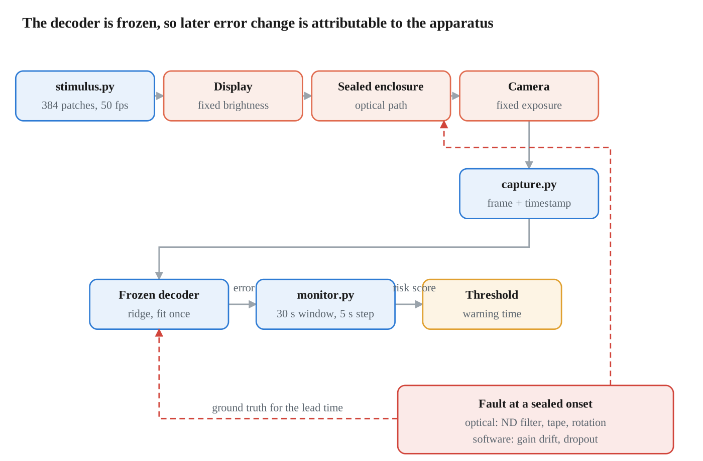
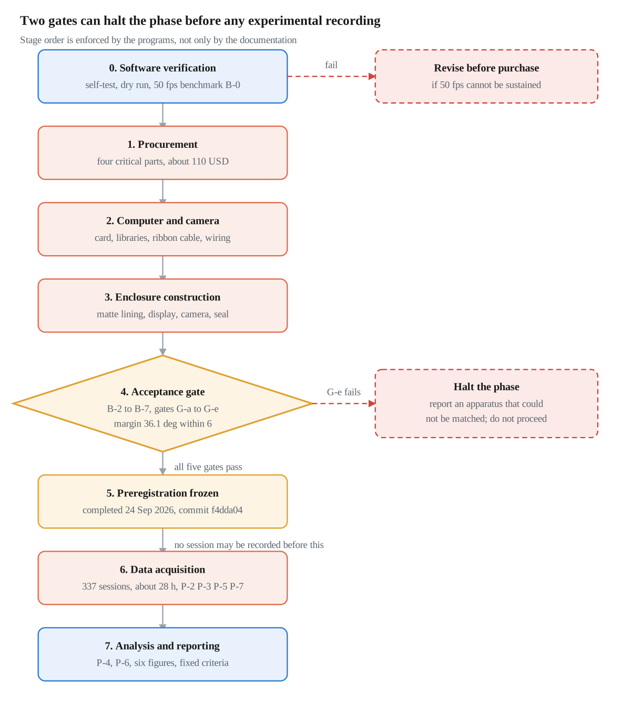
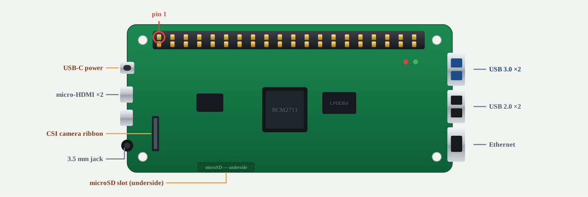
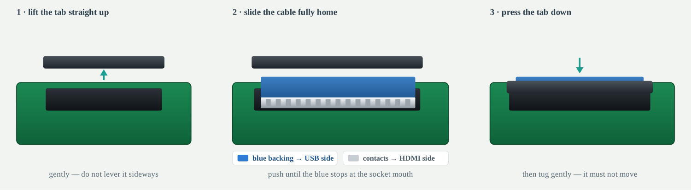
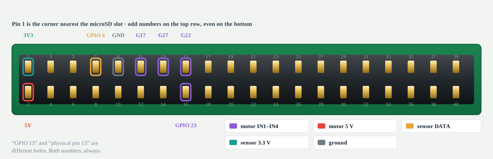
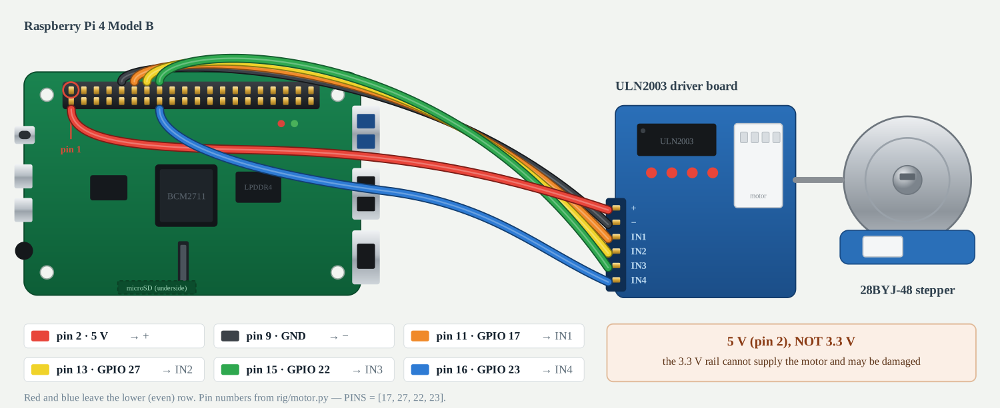
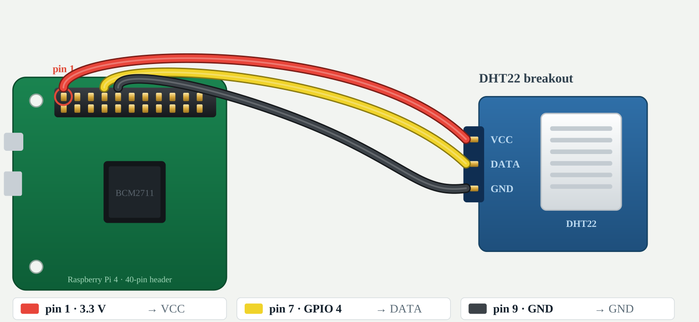
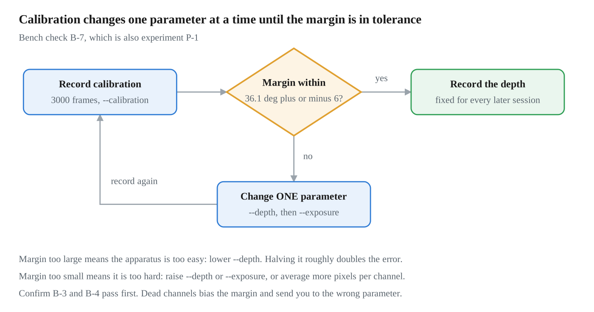
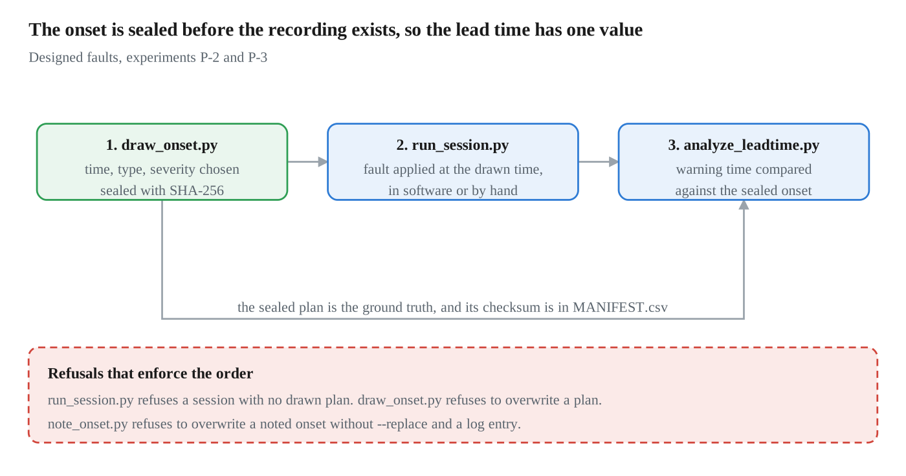

# Physical Validation of a Decoder-Health Monitor: Apparatus Specification and Validation Protocol

**Compiled:** 11 November 2026
**Source:** repository `gnair40/bci-ews-research`, branch `claude/consolidated-2026-11-10`, directory `physical/`
**Preregistration:** frozen 24 September 2026 at commit `f4dda04`

A standalone technical reference for the physical-validation phase, assembled from the
15 specification documents, 17 programs and 1 data-layout note in `physical/`. Figures are
in `physical/figures/`, as PNG for viewing and SVG for editing.

---

## 0. Statement of status

No physical apparatus has been constructed and no measurement has been recorded. The
directory `physical/data/raw/` contains a single placeholder file. Every procedure
described below is specified and software-verified; none has been executed against
hardware.

This document is therefore an apparatus specification and validation protocol,
accompanied by evidence that the acquisition and analysis software executes correctly on
synthetic input. It reports no experimental results, because none exist.

Four status labels are used throughout, and each procedural section carries one.

| Label | Definition | Evidence available |
| --- | --- | --- |
| Implemented | Code exists in the repository and runs to completion on synthetic input from `dryrun.py` | 13 of 13 repository checks pass |
| Specified | A written procedure with numeric acceptance criteria exists, but requires hardware not yet obtained | Source document cited per section |
| Not specified | A parameter an implementer requires that no repository file states | Listed in section 20 |
| Not executed | A specified procedure awaiting the apparatus | Applies to sections 8 through 18 |

The distinction matters for assessment. The software chain has been exercised end to end
and its outputs inspected. The optical, mechanical and electrical assembly has not been
attempted, so no claim about frame integrity, light sealing, timing stability or decoding
difficulty on real hardware appears anywhere in this document.

Sources: `physical/data/raw/` directory contents; `physical/docs/09_PREREGISTRATION.md`
section 10.2; `tools/check_all.py`.

---

## 1. Measurement objective

The apparatus exists to measure two quantities for a decoder-health monitor: the lead time
between the monitor's first warning and the moment decoding performance crosses a failure
threshold, and the false-alarm rate, defined as warnings per hour during recordings in
which no degradation was applied. The project's position is that these two quantities,
reported together, determine whether such a monitor is usable, and that neither can be
obtained from archived human neural recordings.

**Constraint on lead time.** Lead time requires a known degradation onset. In archived
neural recordings the moment of deterioration was never recorded, so an onset can only be
assigned retrospectively by the analyst, and two analysts can obtain two different lead
times from one recording. In this apparatus the onset is drawn by program, written to a
file, and sealed with a SHA-256 checksum before the recording begins. Section 15 describes
the mechanism.

**Constraint on false-alarm rate.** A false-alarm rate requires many hours of recording in
which nothing is wrong. The archived dataset contains approximately 1.4 hours of such
recording, because each recorded block can contribute at most one fault-free episode. The
apparatus records unattended, so fault-free hours are limited by calendar time rather than
by participant availability.

**Scope of inference.** A false-alarm rate obtained from a camera in a sealed enclosure is
not an estimate of the rate an implanted electrode array would produce. The repository
states this limitation in advance rather than as a later concession. The apparatus
supports claims about the monitoring method under a controlled degradation with known
ground truth. It does not support claims about clinical performance.

**Human participants.** The project excludes human participants entirely. No person is
recruited and no device is worn. Data collected from the researcher would also constitute
human-participant research and is excluded. The subject of measurement is the apparatus.

Sources: `physical/docs/00_WHY_THIS_PHASE_EXISTS.md`;
`physical/docs/01_RESEARCH_DESIGN.md` sections 2, 4.4, 5.1 and 7;
`physical/docs/03_MATERIALS_AND_SAFETY.md` section 3.

---

## 2. Experimental variables

Five independent variables are manipulated, five dependent variables are measured, and
seven variables are held fixed. IV5 is set during analysis rather than during recording,
so one recording campaign yields every decision rate without additional sessions.

**Table 2.1. Independent variables.**

| ID | Variable | Levels | Function in the design |
| --- | --- | --- | --- |
| IV1 | Degradation onset time | Drawn at random, sealed before recording | Establishes ground truth for lead time |
| IV2 | Degradation present or absent | Present, absent | Absent sessions provide the false-alarm denominator |
| IV3 | Degradation type | Overall signal loss, channel dropout, per-channel gain drift, geometric rotation | Tests whether findings hold across kinds of failure |
| IV4 | Degradation severity | 0, 0.25, 0.5, 1.0 | Provides a response ladder against severity |
| IV5 | Decision rate | 720 per hour down to 1 per session | Set in analysis; costs no additional recording |

**Table 2.2. Dependent variables.**

| ID | Variable | Operational definition |
| --- | --- | --- |
| DV1 | Lead time | Seconds between the first warning and the moment performance crosses its failure threshold; positive means the warning came first |
| DV2 | False-alarm rate | Warnings per hour of recording in which no degradation was applied |
| DV3 | Detection rate | Fraction of degraded sessions warned about, at a stated false-alarm rate |
| DV4 | Silence-gate pass rate | Fraction of fault-free sessions in which the risk score shows no significant monotonic trend |
| DV5 | Correlation with performance | Correlation between monitor score and task performance, with and without controlling for elapsed time |

DV5 is the comparison variable. It is the quantity the field commonly reports as evidence
that a monitor works. Measuring it on the same sessions as DV1 and DV2 is what tests the
project's hypothesis.

**Table 2.3. Controlled variables.** Each is held fixed because allowing it to vary would
produce an effect indistinguishable from the degradation under study. Five of the seven
are properties of the physical build rather than of the analysis.

| Variable | Held at | Consequence if it varies |
| --- | --- | --- |
| Analysis window | 30 s, stepping 5 s | Breaks comparability with the computational phase |
| Decoder | Ridge regression, fit once on fault-free data | An adapting decoder conceals the drift being measured |
| Camera exposure and gain | Fixed, automatic modes disabled | Auto-exposure compensates for dimming and cancels the fault |
| Screen brightness | Fixed, enhancement modes disabled | Same mechanism as auto-exposure |
| Modulation depth | Fixed after calibration | Alters difficulty, making sessions incomparable |
| Ambient light | Enclosure sealed, darkness verified | Diurnal variation presents as sensor drift |
| Physical geometry | Camera position taped and photographed | Camera movement is itself a geometric fault |

Source: `physical/docs/01_RESEARCH_DESIGN.md` section 4, tables 4.1 to 4.3.

---

## 3. Signal chain architecture

The apparatus is a closed optical loop with a known input. A stimulus program encodes a
moving direction across 384 independently modulated screen patches, which stand in for 384
recording channels. A camera inside a sealed enclosure images those patches at 50 frames
per second, so that one camera frame corresponds to one 20 ms bin in the neural recordings
the apparatus imitates. A frozen ridge decoder estimates the encoded direction from the
384 channel values, a monitor converts a 30-second window of decoder behaviour into a risk
score, and a fixed threshold converts that score into warnings.

The fault path is shown separately in Figure 3.1 because it performs two distinct
functions. It degrades the signal, optically or in software, and it supplies the
ground-truth onset time against which any warning is scored. The decoder is fit once and
then frozen precisely so that a later change in decoding error is attributable to the
apparatus rather than to decoder adaptation.

**Figure 3.1.** Blue denotes a software process, orange a physical element, amber a
calibrated constant, and red the injected fault. The fault path reaches both the optical
stage and the decoder, because it corrupts the signal and also supplies the onset against
which the warning is scored.

---

## 4. Bill of materials

Status: not procured. No item in this table has been purchased. Approximate total is 150
US dollars, or about 110 if a spare display is available. Prices are from autumn 2026 and
are budgetary rather than quoted.

Items 1 to 4 are the critical path; no other work can begin until they arrive. Several
entries carry a specific justification because a nearby substitute would invalidate the
measurement.

| # | Item | Specification | Cost (USD) | Justification |
| --- | --- | --- | --- | --- |
| 1 | Single-board computer | Raspberry Pi 4 Model B, 4 GB | 55 to 65 | A Pi Zero cannot sustain 50 frames per second. A Pi 5 uses a different camera connector and software stack |
| 2 | Camera | Raspberry Pi Camera Module 3 with supplied ribbon cable | 25 to 35 | The Pi 4 connector is the older wider type. A separately bought Pi 5 cable will not fit |
| 3 | Storage | microSD, 32 to 64 GB, class A2 or U3 | 8 to 12 | Slower cards drop frames during recording |
| 4 | Power supply | Official Raspberry Pi USB-C, 5 V 3 A | 8 to 12 | Phone chargers sag under load and the Pi throttles silently, changing the recording rate mid-session |
| 5 | Display | Any monitor or tablet, 1280 x 720 or better, manual brightness | 0 to 40 | Automatic brightness, ambient-light adjustment and power-saving dimmers all cancel the degradation being measured |
| 6 | Enclosure | Cardboard box, at least 40 x 30 x 30 cm | 0 to 8 | Houses the display and camera at fixed separation in darkness |
| 7 | Internal lining | Matte black paper or matte black paint | 6 to 12 | Gloss reflects, which couples channels that the analysis treats as independent |
| 8 | Camera mount | Small tripod or rigid bracket | 8 to 15 | Must not move. A shift of one millimetre redefines every channel |
| 9 | Sealing | Black gaffer or electrical tape | 6 to 10 | Seals the cable aperture and lid seams |
| 10 | Optical attenuator | Photographic neutral density gel, ND 0.6 | 8 to 15 | Produces the signal-loss fault optically. Inert plastic |
| 11 | Actuator | 28BYJ-48 stepper motor with ULN2003 driver board | 6 to 10 | Rotates the stage for the geometric fault in repeatable units |
| 12 | Interconnect | Female-to-female jumper wires, 20 cm, six required | 5 to 8 | Connects the driver board to the Pi. No soldering |
| 13 | Environmental sensor | DHT22 or AM2302 on a breakout board with pull-up fitted | 5 to 10 | Camera noise roughly doubles every 6 to 8 degrees Celsius, so unlogged room warming is indistinguishable from sensor drift |
| 14 | Bulk storage | USB flash drive, 64 GB | 8 to 12 | The whole campaign is 337 sessions at 23.7 MB each, about 8 GB |

Items 10 to 13 are required for experiments P-3 and P-5 but not for construction or
calibration. The repository notes that the geometric rotation fault is also available in
software, so item 11 is optional; its purpose is to impose a physical rotation that no
equation was written for.

Sources: `physical/docs/03_MATERIALS_AND_SAFETY.md` section 2;
`physical/docs/11_SHOPPING_LIST.md`.

---

## 5. Safety assessment

Status: specified. The assessment is recorded in the repository and covers the four hazard
classes present in the build.

| Element | Assessment |
| --- | --- |
| Power | 5 V DC from a regulated USB supply. No mains wiring, no exposed conductors, and no batteries beyond a sealed USB power bank |
| Stepper motor | 5 V, low torque. Operated only with the enclosure closed, hands clear while powered. Connected to the 5 V pin, never the 3.3 V pin, which cannot supply it and may be damaged |
| Display | Standard consumer screen inside a closed enclosure. Not viewed at close range at high brightness |
| Optical attenuator | Photographic neutral density gel. Inert plastic, no chemical hazard |

No item in the build is age-restricted or hazardous. The enclosure is cardboard and
contains no heat source beyond the single-board computer and display, both of which
operate at their normal ratings.

Source: `physical/docs/03_MATERIALS_AND_SAFETY.md` section 3.

---

## 6. End-to-end validation workflow

The phase proceeds in seven stages. The ordering is enforced by the programs themselves,
not only by documentation: `run_session.py` refuses to record a session with no drawn
plan, and the analysis programs refuse to run before the session table exists.

Three points in the sequence are decision gates rather than steps. Stage 1 can halt
procurement, because if the computer cannot sustain 50 frames per second the design
changes before money is spent. Stage 4 is the acceptance gate of section 11, and gate G-e
can terminate the phase. The preregistration freeze sits between calibration and
recording, and no session may be recorded before it.

**Figure 6.1.** Blue denotes a software process, orange a physical construction stage,
amber a gate, and red a halt condition. Stage 0 precedes procurement deliberately, because
a computer that cannot sustain 50 frames per second changes the design before money is
spent. Stage 5 is complete; every other stage is outstanding.

---

## 7. Software inventory

Status: implemented. The directory `physical/code/` contains 17 programs. All execute to
completion on synthetic input. Section 19 records what that verification covers and what
it does not.

| Program | Stage | Function |
| --- | --- | --- |
| `monitor.py` | Shared core | Window extraction, decoder fitting, risk scoring, threshold selection. Imported by the analysis programs rather than duplicated. Also provides `--selftest` |
| `dryrun.py` | Pre-hardware | Fabricates synthetic recordings so the whole chain can run before the apparatus exists. Also provides `--cleanup` |
| `stimulus.py` | Recording | Draws the 24 x 16 patch grid at 50 fps with modulation depth 0.00211. Provides `--benchmark` |
| `capture.py` | Recording | Drives the camera, writes frames and per-frame timestamps |
| `run_session.py` | Recording | Runs one session: starts stimulus and capture, records metadata, reads room temperature |
| `run_campaign.py` | Recording | Draws and records many sessions unattended; reports remaining work |
| `draw_onset.py` | Recording | Selects onset time, fault type and severity, writes the plan file and seals it with a checksum |
| `note_onset.py` | Recording | Records an onset observed after the fact, for hand-imposed faults in P-5 |
| `bench.py` | Verification | Implements bench checks: `darkframe`, `frames`, `lag`, `dither`, `margin`, and `check` to run several |
| `health_check.py` | Verification | Daily campaign integrity check: disk space, screen sleep, drift in fault-free sessions |
| `make_session_table.py` | Analysis | Builds the session table, assigns fit, validation and test groups, selects the warning threshold |
| `analyze_falsealarm.py` | Analysis | Experiment P-2: false-alarm rate and the silence gate |
| `analyze_leadtime.py` | Analysis | Experiment P-3 lead time; with `--undesigned`, experiment P-5 reported separately |
| `analyze_correlation.py` | Analysis | Experiment P-4: correlation between monitor score and performance |
| `analyze_decision_rate.py` | Analysis | Experiment P-6: the decision-rate curve |
| `analyze_apparatus.py` | Analysis | Experiment P-7: compares apparatus configurations and evaluates predictions PP-9 and PP-10 |
| `figures.py` | Analysis | Produces the six figures from stored results |

**Three design decisions in the code are scientific rather than technical.** The
repository identifies them explicitly.

1. The decoder is fit once on fault-free sessions and then frozen, rather than refitted per
   session. A refitting decoder would absorb the drift the experiment is trying to detect.
   The per-session refit is retained as a stated sensitivity check, not as the primary
   analysis.
2. A warning is timestamped at the end of the window that produced it, because that is the
   earliest moment its score could have been computed. Windows are 30 seconds long and
   start every 5 seconds, so detection delays are resolvable only to about 5 seconds.
3. Lead time and detection delay are distinct quantities and are reported separately.

**Provenance marking.** Any report or figure generated from synthetic input carries a
visible marker. Reports receive a banner reading that they are not data, figures receive a
diagonal watermark, and `dryrun.py --cleanup` removes the synthetic recordings together
with everything they produced. A table is deleted only if its own metadata records it as
synthetic, so the cleanup cannot remove a real result.

Sources: `physical/docs/05_SOFTWARE.md`; `physical/code/` file listing.

---

## 8. Computer preparation

Status: specified, not executed. Steps 8.1 to 8.5 prepare the single-board computer before
any enclosure work. Each step ends with a check that must pass before the next begins.

**Figure 8.1.** Board layout. Pin 1 of the header is the corner nearest the microSD slot.
The camera ribbon connector is the narrow black socket set inboard of the left edge,
between the micro-HDMI sockets and the audio jack. Only the header, the camera connector,
the microSD slot and the power socket are used in this build.

1. **Write the operating system to the card.** On a separate computer, install Raspberry Pi
   Imager. Select Raspberry Pi OS, 64-bit. Open the settings panel and set a hostname, a
   username and password, the wireless network details, and enable SSH. Write the card.
   - Check: the imager reports a successful write and verification. A card that fails
     verification will drop frames later and must not be used.
   - Reason for enabling SSH now: once the enclosure is sealed and taped, opening it to
     attach a keyboard breaks the light seal and requires the darkness check to be
     repeated.
2. **First boot.** Insert the card, connect power, wait two minutes. From the separate
   computer, open a terminal and connect with `ssh <username>@<hostname>.local`.
   - Check: a command prompt appears. If the hostname does not resolve, find the numeric
     address in the router's device list and use that instead.
3. **Install the libraries.** Run `sudo apt update`, then
   `sudo apt install -y python3-picamera2 python3-pygame python3-numpy python3-scipy python3-pandas git`.
   - `picamera2` drives the camera, `pygame` draws the stimulus, `numpy`, `scipy` and
     `pandas` perform the arithmetic, and `git` retrieves the project.
   - These are installed through the system package manager rather than `pip` because on
     Raspberry Pi OS the camera library is built against the system and the `pip` build
     generally does not work.
4. **Retrieve the project.** Run `git clone https://github.com/gnair40/bci-ews-research.git`,
   then `cd bci-ews-research`, then `git checkout claude/consolidated-2026-11-10`.
   - The branch checkout is required at present. The default branch does not yet carry the
     frozen preregistration, and the protocol prohibits recording against an unfrozen
     preregistration. The step can be removed once the branch is merged.
5. **Verify the software chain.** Run `python3 physical/code/monitor.py --selftest`.
   - Expected output: `PASS, the pipeline is wired up correctly`.
   - If this passes on the separate computer but fails here, an item in step 3 did not
     install.

**Attaching the camera.** Power the computer off and disconnect it before step 8.6.

6. Locate the camera connector, a narrow black socket set inboard of the left edge between
   the micro-HDMI sockets and the audio jack.
7. Lift the connector's plastic tab straight up. Do not lever it sideways.
8. Insert the ribbon cable with the silver contacts facing the HDMI sockets and the blue
   plastic backing facing the USB sockets. Push until the blue backing stops at the socket
   mouth.
9. Press the tab down, then tug the cable gently. It must not move.
10. Restore power and run `rpicam-hello --list-cameras`.
    - Expected output: one camera listed, with a model name.
    - If nothing is listed, the cable is reversed or incompletely seated. This is the most
      common failure at this stage and re-seating resolves it in most cases. The camera
      module end uses the same style of connector and should be checked second.

**Figure 8.2.** Ribbon cable orientation, steps 8.7 to 8.9. The silver contacts face the
HDMI sockets and the blue plastic backing faces the USB sockets. The cable is pushed in
until the blue backing stops at the socket mouth.

Sources: `physical/docs/04_BUILD.md` sections 2.1 to 2.5; `physical/docs/12_RUNBOOK.md`
stages 0 and 2.

---

## 9. Electrical interfaces

Status: specified, not executed. Seven of the forty header positions are used. All pin
assignments below were read from the programs that drive the hardware rather than from
prose, because the two disagreed until 10 November 2026; section 20 records the
correction.

| Subsystem | Signal | GPIO (BCM) | Physical pin | Source of the assignment |
| --- | --- | --- | --- | --- |
| Stepper driver | IN1 | GPIO 17 | 11 | `rig/motor.py`, `PINS = [17, 27, 22, 23]` |
| Stepper driver | IN2 | GPIO 27 | 13 | `rig/motor.py` |
| Stepper driver | IN3 | GPIO 22 | 15 | `rig/motor.py` |
| Stepper driver | IN4 | GPIO 23 | 16 | `rig/motor.py` |
| Stepper driver | Supply, 5 V | not applicable | 2 | `physical/docs/04_BUILD.md` |
| Stepper driver | Ground | not applicable | 9 | `physical/docs/04_BUILD.md` |
| Environmental sensor | DATA | GPIO 4 | 7 | `rig/logtemp.py`, `--pin` default 4 |
| Environmental sensor | Supply | not applicable | 1, recommended | Not specified in the repository, see section 20 |
| Environmental sensor | Ground | not applicable | 9, recommended | Not specified in the repository, see section 20 |

**Counting convention.** Physical pin 1 is the corner nearest the microSD slot.
Odd-numbered pins run along one row and even-numbered pins along the other. GPIO numbering
and physical pin numbering are distinct schemes that share small integers: GPIO 13 is
physical pin 33, while physical pin 13 is GPIO 27. Every row above therefore states both
numbers.

**Supply rail.** The stepper motor is connected to the 5 V pin, never the 3.3 V pin. The
3.3 V rail cannot supply the motor and may be damaged.

**Verification.** The motor subsystem is tested with `python3 rig/motor.py --degrees 2`,
which should turn the shaft about two degrees and then de-energise the coils, followed by
`python3 rig/motor.py --degrees -2` to return it. The program requires either `--degrees`
or `--steps`; invoked with neither it exits with an error rather than moving. There is no
encoder, so the cumulative position is written in the log after every movement. A motor
wired to incorrect pins produces no error message, because the program drives four pins and
cannot detect whether anything is attached to them. If the shaft buzzes without turning,
two control wires are transposed or the supply is on 3.3 V. The sensor is tested with
`python3 rig/logtemp.py --once`, which prints a temperature and humidity pair; the DHT22
fails a fraction of reads by design, so a single failed read is not evidence of a wiring
fault.

**Figure 9.1.** Header allocation. Seven of the forty positions are used. Ring colours
group the signals by subsystem: purple for the four stepper control lines, red for the
motor supply, amber for the sensor data line, teal for the sensor supply, and grey for
ground.

**Figure 9.2.** Stepper subsystem, six connections. The red and blue wires leave the
lower, even-numbered row of the header and pass beneath it before joining the bundle. Pin
16 is the only one of the four control lines not on the odd row, which is the most
frequent wiring error for this subsystem.

**Figure 9.3.** Environmental sensor subsystem, three connections. Only the yellow data
line is fixed by the repository, through the `--pin 4` default in `rig/logtemp.py`. The red
and black connections shown are the recommendation described in section 20 and are not
stated in any repository file.

Sources: `rig/motor.py`; `rig/logtemp.py`; `physical/docs/04_BUILD.md` section 3.5;
verified on every repository check run by `scripts/81_hardware_pins.py`.

---

## 10. Enclosure construction and optical control

Status: specified, not executed. The enclosure fixes the display and camera at a constant
separation in darkness. Its three requirements are a matte interior, a rigid camera mount,
and a light seal verified by measurement rather than by eye.

1. **Line the interior.** Cover every interior face, including the lid, with matte black
   paper or matte black paint. Leave no cardboard exposed, and treat corners and seams as
   carefully as the large faces.
   - Reason: the analysis treats the 384 patches as independent channels, in the same way a
     neural recording treats separate electrodes. A gloss surface places a faint reflected
     copy of the display onto other regions of the image, which correlates channels that
     the analysis assumes are independent. The monitor then detects structure that is a
     property of the enclosure. No later processing step can separate that from a real
     result.
2. **Mount the display** at one end, facing inward, filling as much of that end as possible.
3. **Configure the display and record the settings.** Set brightness to a fixed mid-scale
   value and write the numeric value in the research log. Disable automatic brightness,
   ambient light sensing, dynamic contrast, any enhancement or vivid mode, and all
   power-saving dimmers. Set the screen never to sleep.
   - Reason: the modulation depth is 0.00211 of full scale, which is approximately half of
     one brightness level in 255. Every automatic display feature adjusts the image by more
     than that, on its own schedule, without recording anything.
   - A display whose automatic brightness cannot be disabled is not usable for this
     experiment. This should be established with a display that can still be returned.
4. **Mount the camera** at the opposite end on its tripod or bracket, pointing at the
   display. Push it gently; it must not deflect. Aim so that the patch grid fills the camera
   field with a small margin.
   - Reason: a channel is defined as a fixed region of the display imaged onto a fixed
     region of the sensor. A camera displacement of one millimetre redefines every channel,
     which divides the campaign into two incompatible halves with no record of the boundary
     in the data.
   - If the camera is disturbed during a campaign, record the date and time in the research
     log. A documented displacement can be handled in analysis; an undocumented one cannot
     be detected.
5. **Seal the enclosure.** Route the power and display cables through a single aperture,
   then tape around the cables at that aperture. Tape the lid seams, then any remaining seam
   that passes light.
6. **Verify darkness by measurement**, not by eye. The acceptance test is bench check B-2 in
   section 12. A dark room contains considerably more light than this enclosure is
   permitted.

If the enclosure cannot be sealed to the stated threshold, the check instructs the operator
to record a dark frame each session and subtract it. This must be recorded as a documented
deviation. A subtracted offset is not equivalent to no offset when the quantity being
measured is drift.

Sources: `physical/docs/04_BUILD.md` sections 3.1 to 3.4;
`physical/docs/01_RESEARCH_DESIGN.md` table 4.3.

---

## 11. Acceptance gates

Status: preregistered, frozen 24 September 2026 at commit `f4dda04`. Five gates must pass,
in the order given, before any experimental recording begins. The preregistration states
that a prediction evaluated on an apparatus that has not cleared the gate is not evidence
about anything.

| Gate | Condition | Verified by |
| --- | --- | --- |
| G-a | Enclosure is light-tight: mean pixel below 2, maximum below 5, of 255 | `bench.py darkframe` |
| G-b | Recordings arrive intact: under 1% late frames, under 5% dead channels, under 1% clipped | `bench.py frames` |
| G-c | Display-to-camera delay is measured and agrees across three recordings | `bench.py lag` |
| G-d | Sub-brightness-level signal survives: median agreement above 0.02, positive on more than 80% of channels | `bench.py dither` |
| G-e | Decoding difficulty matches the neural recordings: margin within 6 degrees of 36.1 degrees | `bench.py margin` |

**G-e is the gate that can halt the phase.** Section 13 describes the calibration procedure
and the reasoning behind the target value.

**Preregistered response if G-e cannot be met.** The preregistration fixes the response in
advance, before the apparatus existed:

1. Record the achieved margin and every adjustment attempted, in the research log.
2. Report the phase as an apparatus that could not be matched to the neural operating
   point, stated plainly.
3. Do not proceed to the predictions on an unmatched apparatus and describe the results as
   though the match had held.

The document notes that a phase stopping at this point has still produced the benchmark
design, the code, and a measured reason the apparatus did not work, which it judges more
valuable than results from an apparatus known to be too easy.

Source: `physical/docs/09_PREREGISTRATION.md` sections 3 and 7.

---

## 12. Bench verification procedures

Status: specified, not executed. Eight checks, estimated at one hour in total. The
repository's stated rationale is that each check catches a failure that produces plausible
numbers rather than an obvious error. An apparatus that crashes is inexpensive because the
failure is immediate. An apparatus that is subtly wrong produces a complete campaign of
normal-looking data that means nothing.

| Check | Question | Command | Acceptance criterion |
| --- | --- | --- | --- |
| B-0 | Can this machine draw at 50 fps? | `stimulus.py --benchmark 300` | Well under 60% of the 20 ms per-frame budget |
| B-1 | Does the software run? | `monitor.py --selftest` | PASS |
| B-2 | Is the enclosure light-tight? | `bench.py darkframe` | Mean pixel below 2, maximum below 5 |
| B-3, B-4 | Did the recording arrive intact? | `bench.py frames` | Under 1% late, under 5% dead, under 1% clipped |
| B-5 | What is the display-to-camera delay? | `bench.py lag` | Agreement across three recordings |
| B-6 | Does the sub-level signal survive? | `bench.py dither` | Median above 0.02, positive on over 80% of channels |
| B-7 | Is the difficulty correct? | `bench.py margin` | 36.1 degrees plus or minus 6 |

Checks B-3 to B-7 can be run together with `bench.py check --session 0 --block 1`.

**B-0, frame rate.** The budget is 20 ms per frame. The repository notes that the reported
figure covers drawing arithmetic only, and that the display flip costs more on top, so
anything above about 60% is tight. The reason for 50 fps specifically is that the neural
recordings the apparatus imitates are binned at 20 ms, so at 50 frames per second one
camera frame corresponds to one neural bin. A short benchmark cannot detect thermal
throttling, which appears later as late frames on a full-length recording.

**B-2, darkness.** The failure this prevents is not a wrong number but a correct number
about the wrong thing. Ambient light varies through the day and produces a genuine,
detectable, correlated drift across every channel, which is the signature the monitor is
designed to find. Remedy order for a failure: re-tape the cable aperture, then the lid
seam, then the bezel.

**B-3 and B-4, recording integrity.** Two failures look identical from outside and have
different causes. Late frames mean the computer could not keep up; the remedies are a lower
frame rate, closing other programs, or a faster card. Dead channels mean part of the grid
falls outside the camera field or lies in shadow; the remedy is to reposition the camera or
display and record again. A dead channel is more damaging than its threshold suggests,
because a channel fixed at a constant value contributes no information while carrying full
weight in the decoder fit. The decoder then performs worse, the apparatus appears harder
than it is, and B-7 reports a margin that leads the operator to adjust the wrong parameter.

**B-5, timing.** The stimulus and capture programs are independent, so the camera records
slightly after the display changes. The delay is measured from the signal itself, requiring
no additional hardware, and written to `physical/data/lag.json`, which the analysis
programs read automatically. A constant delay is simply subtracted. The failure that
matters is an inconsistent delay, because no fixed correction can undo a varying one. The
stated remedies are to drop to 25 fps, or to hold each direction for five seconds with
`--hold 250` and analyse only the middle three.

**B-6, dither survival.** The apparatus requests a brightness the display cannot produce,
for example 100.5, by setting approximately half the pixels in a patch to 100 and half to
101. The camera, averaging over the patch, records the intermediate value. A small measured
agreement is the correct result; a large agreement would indicate the calibration is wrong.
The risk is that many panels are internally 6-bit and perform their own dithering, which
interferes with this. The repository recommends establishing this with a display that can
be returned.

Sources: `physical/docs/04_BUILD.md` parts 4 and 5;
`physical/docs/09_PREREGISTRATION.md` section 3.

---

## 13. Difficulty calibration

Status: specified, not executed. This procedure is both bench check B-7 and experiment P-1.

**Target.** The reference neural decoder operates at 54.6 degrees of angular error against
a measured chance level of 90.7 degrees, giving a margin of 36.1 degrees. The apparatus
must be tuned to within 6 degrees of that margin before any other recording. The constants
are held in `physical/code/bench.py` as `NEURAL_MARGIN = 36.1` and
`MARGIN_TOLERANCE = 6.0`.

**Rationale.** If the direction can be decoded perfectly, degrading the apparatus changes
the output very little, so there is nothing for a monitor to detect. More seriously,
comparing a system that decodes perfectly against one that barely exceeds chance measures
difficulty rather than monitoring performance. The match places the apparatus at the same
operating point as the recordings it stands in for.

**Adjustment parameter.** Modulation depth, the `--depth` argument to `stimulus.py`,
default 0.00211.

1. Record a calibration session:
   `run_session.py --session 0 --block 1 --calibration --frames 3000`. 3000 frames is one
   minute. The `--calibration` flag marks the session as setup rather than data, and every
   analysis program excludes such sessions, on the stated principle that an apparatus being
   adjusted is not an apparatus being measured.
2. Run `bench.py margin --session 0 --block 1`.
3. If the margin is too large, the apparatus is too easy: reduce `--depth`. Halving it
   approximately doubles the error.
4. If the margin is too small, the apparatus is too hard: raise `--depth`, or raise
   `--exposure`, or average more pixels per channel by increasing the capture size toward
   96 x 64.
5. Change one parameter only, record another calibration session, and repeat from step 2.
6. When the margin falls within 6 degrees of 36.1, record the final `--depth` value in the
   research log and do not change it again.

The repository states that every later session must use the recorded depth value. If it
changes mid-campaign, sessions recorded before and after are not comparable, and nothing in
the data will reveal that afterwards.

Before adjusting depth, confirm that B-3 and B-4 pass. Dead channels bias the margin, and
tuning depth to compensate for them adjusts the wrong parameter.

**Figure 13.1.** The loop terminates only when the measured margin falls within tolerance.
The constraint that one parameter changes per iteration exists because three parameters
affect the margin, and changing more than one makes the resulting value uninterpretable.

Sources: `physical/docs/04_BUILD.md` part 5, B-7; `physical/code/bench.py` constants;
`physical/code/stimulus.py` defaults.

---

## 14. Experiment matrix

Status: preregistered. Session counts were frozen on 24 September 2026 and may not be
changed without an appended amendment stating whether the data had been seen.

| Experiment | Measures | Sessions | Recording time | Attended |
| --- | --- | --- | --- | --- |
| P-1 | Calibration, the difficulty match | 5 minimum | 25 min | Yes, iterative |
| P-2 | False-alarm rate on fault-free sessions | 101 | 8.4 h | No, one unattended night |
| P-3 | Lead time from a sealed onset | 101 | 8.4 h | Partly |
| P-4 | Correlation against usability | 0 | Minutes | Analysis only |
| P-5 | Faults not designed in software | 10 | 50 min | Yes, imposed by hand |
| P-6 | Decision-rate curve | 0 | Minutes | Analysis only |
| P-7 | Apparatus variation, 3 configurations | 120 | about 10 h | No, three further nights |
| **Total** | | **337** | **about 28 h** | Mostly unattended |

Two of the seven experiments require no additional recording. The decision rate and the
correlation are alternative scorings of sessions already collected, which is a substantial
part of what makes the campaign affordable.

**Fault-free campaign length.** The arm was fixed at 101 sessions. The consequence was
stated in advance. After the fit and threshold-selection groups are removed, 101 sessions
leave approximately 4 held-out test hours. Zero false alarms in 4 hours bounds the rate at
approximately 0.75 per hour by the rule of three, which is seven times the 0.1 per hour
budget. The preregistration therefore records that a quiet result is reported as untested
rather than as a pass. Reaching the falsifiable regime would require approximately 480
sessions and about 30 held-out hours, which was considered and declined against the fair
date.

**Cut order if time runs short**, decided before the campaign: P-5 first, then P-7, then the
middle severity level of P-3. P-2 is never cut. It is the measurement the project argues
cannot be made elsewhere, it runs unattended, and every other result is reported against
the warning threshold it produces.

Sources: `physical/docs/02_EXPERIMENTS.md` summary table;
`physical/docs/09_PREREGISTRATION.md` section 4 and prediction PP-1.

---

## 15. Onset determination and sealing

Status: implemented. This protocol is the mechanism that makes lead time a measurable
quantity, and it is the methodological core of the phase.

**Procedure for designed faults, experiments P-2 and P-3.**

1. Before each session, run `draw_onset.py`. The program selects the onset time, the fault
   type and the severity, writes them to a plan file, and seals that file with a SHA-256
   checksum recorded in `physical/data/onsets/MANIFEST.csv` together with the time of
   writing.
2. Record the session. The degradation begins at the drawn time, applied in software for
   gain and rotation faults and by hand for optical faults, using a timer and the filter.
3. Analyse with `analyze_leadtime.py`, which compares the warning time against the sealed
   onset.

**Enforcement.** `run_session.py` refuses to record a session that has no drawn plan.
`draw_onset.py` refuses to overwrite an existing plan. `note_onset.py` refuses to overwrite
a noted onset without the `--replace` flag and a corresponding log entry. The scripts
enforce the order because the order is the argument.

**Rationale.** If the onset is selected after the recording, the lead time depends on the
person selecting it, and two analysts obtain two values from one recording. Sealing the
plan with a checksum beforehand makes that impossible and makes the claim checkable by a
reader who does not trust the researcher. The plan files are committed to the repository
while the recordings are not, because the plans are a few hundred bytes each and are the
artifacts that make the measurement verifiable.

**Procedure for undesigned faults, experiment P-5.** Here the onset cannot be sealed in
advance, because the fault is imposed by hand and occurs when the operator manages it.
`note_onset.py` records the onset afterwards. The repository treats this as a deliberate
downgrade in evidential strength: P-5 results are reported in a separate table, and a
session with no noted onset is refused by the analysis rather than estimated.

**Mistimed hand-imposed faults.** A late fault is recoverable; a silently late fault is not.
The procedure is to record the session with an explanatory note, for example
`run_session.py --session 20 --block 7 --note "filter applied approximately 4 s late"`.

**Figure 15.1.** Green marks the sealed artifact. The order is enforced by the programs
rather than by instruction, which is what makes the resulting lead time checkable by a
reader who does not trust the researcher.

Sources: `physical/docs/02_EXPERIMENTS.md` P-3 and P-5 protocols;
`physical/docs/05_SOFTWARE.md`; `physical/data/_FOLDER_NOTES.md`.

---

## 16. Data acquisition and data layout

Status: implemented in software, not executed against hardware.

**Per-session measurements.** A full-length session is 15,000 frames at 50 fps, which is
five minutes. Measured storage per session is 23.7 MB, comprising `capture.npy` at 23.0 MB,
`stim.csv` at 0.6 MB, and `capture_t.npy`. Analysis time is 0.58 s per session.

**Fault-free campaign procedure, experiment P-2.**

1. Draw all plans in one operation: `run_campaign.py plan --session 10 --healthy 101`. This
   draws and checksums every plan.
2. Start recording in the evening: `run_campaign.py record --session 10`. The arm is 101
   sessions at five minutes each, approximately 8.4 hours.
3. Change nothing during the campaign. No cleaning, no refocusing, no re-seating of cables.
   If something is changed, record it in the log with the date, because an undocumented
   mid-campaign intervention cannot be detected afterwards and invalidates the arm.
4. The following morning, run `health_check.py` before anything else. It detects the
   display having slept, the disk having filled, and other overnight failures that produce
   recordings which appear normal.

**Stopping rules**, fixed in advance:

- Recording stops at the planned count, not when a result appears. The analysis programs are
  not run against the accumulating campaign to decide whether to continue.
- A session is never discarded because of its result. Sessions are discarded only for
  recorded mechanical reasons, and every discard is written in the research log with its
  reason at the time.
- Exclusion is performed by adding a row to `physical/data/EXCLUSIONS.csv` with a reason and
  a date. A row with no reason is refused by the tooling, because an unexplained exclusion
  cannot be distinguished from dropping a session on the basis of its outcome.
- Recordings are never deleted and never edited.

**Data layout.**

| Directory | Contents | Committed |
| --- | --- | --- |
| `physical/data/onsets/` | Drawn plans and `MANIFEST.csv` | Yes |
| `physical/data/raw/` | Camera recordings | No, too large |
| `physical/data/processed/` | Per-window arrays, `table_meta.json` | Partly |
| `physical/data/results/` | Reports and their JSON | Yes |
| `physical/data/dryrun/` | Synthetic recordings for testing | Never |

`physical/data/lag.json` and `preferred_directions.npy` are committed. Nothing modifies
anything in `raw/`: it is written once by `run_session.py` and read thereafter, and every
analysis writes to `processed/` or `results/`. The stated reason is that a recording which
has been cleaned up cannot be un-cleaned, and a result depending on an unrecorded cleaning
step cannot be reproduced by anyone, including the person who performed it.

Sources: `physical/docs/06_DATA_COLLECTION.md`; `physical/data/_FOLDER_NOTES.md`;
`physical/docs/09_PREREGISTRATION.md` section 4.

---

## 17. Analysis pipeline

Status: implemented. Estimated 20 minutes on a laptop. Only recording requires the
single-board computer.

1. Copy the recordings from the computer to the analysis machine.
2. Build the session table: `make_session_table.py`. Read its printed summary before
   anything else; it reports what the campaign actually contains.
3. Run the analyses in order: `analyze_falsealarm.py` for P-2, `analyze_leadtime.py` for
   P-3, `analyze_leadtime.py --undesigned` for P-5, `analyze_correlation.py` for P-4, and
   `analyze_decision_rate.py` for P-6.
4. Produce the figures: `figures.py all`. Six figures are written.
5. Analyse each apparatus configuration separately for P-7, each with its own decoder and
   threshold, then compare with `analyze_apparatus.py --configs A,B,C,D`. Pooling
   configurations would average over the variable being manipulated.
6. Run the sensitivity check with the alternative decoder:
   `make_session_table.py --decoder per-session --tag _persession`.

**Group separation.** Sessions are divided into three disjoint groups: fit,
threshold-selection, and reporting. The false-alarm rate and lead time are reported only
from the third. A monitor evaluated on the sessions used to build or tune it will appear
better than it is.

**Analysis plan fixed in advance.** Windows are 30 s stepping 5 s, matching the neural
analysis. The decoder is fit once on the earliest fault-free sessions and frozen. The
per-session refit is run as a stated sensitivity check, not as the primary analysis.

**Decision rule for the false-alarm comparison.** The comparison uses the upper end of the
95% interval, not the observed rate. With approximately 4 held-out test hours, a monitor
producing zero false alarms has an observed rate of exactly zero, which is not a rate but
an upper bound of approximately 0.75 per hour. Treating that zero as within budget would
report the shortness of the campaign as a property of the monitor. `analyze_falsealarm.py`
implements this as `within_budget = hi <= budget`.

**Pre-hardware rehearsal.** `dryrun.py` fabricates recordings so the entire chain can be
executed before any apparatus exists. Its outputs carry a visible not-data marker, and
`dryrun.py --cleanup` removes the synthetic recordings and everything generated from them.

Sources: `physical/docs/07_ANALYSIS.md`; `physical/docs/12_RUNBOOK.md` stage 10;
`physical/docs/09_PREREGISTRATION.md` sections 1 and 5.

---

## 18. Decision criteria

Status: preregistered, frozen before the apparatus existed. Each outcome is mapped to a
reported conclusion in advance, which removes the opportunity to reframe a disappointing
result after the data are seen.

| Observed outcome | Reported conclusion |
| --- | --- |
| False alarms above the 0.1 per hour budget | The predicted outcome. Quantifies the excess, which is not currently known for any monitor of this class |
| Zero false alarms in approximately 4 held-out hours | Untested, not passed. The rate is bounded at approximately 0.75 per hour; the campaign cannot distinguish a quiet monitor from an untested one |
| Median lead time at or below zero | The monitor warns after the failure it was intended to anticipate. Usable as a detector, not as a warning |
| Strong correlation and unusable on both counts | Hypothesis supported: correlation with performance is not sufficient evidence that a monitor works |
| Strong correlation and usable on both counts | Hypothesis falsified, and reported as such |
| No correlation measure reaches 0.70 | Inconclusive, which is recorded as a real outcome. A weakly correlated monitor says nothing either way |
| Margin never reaches 36.1 plus or minus 6 degrees | Report as an apparatus that could not be matched, with the achieved margin and every adjustment attempted. Do not run the predictions |

**Judging rule.** The monitor is classified as unusable if the median lead time is at or
below zero, or the 95% upper bound on the false-alarm rate exceeds the budget. A result is
Supported if the correlation is strong and the monitor is unusable, Falsified if the
correlation is strong and the monitor is usable on both counts, and Inconclusive if no
correlation measure reaches 0.70.

The preregistration states that Inconclusive is a real outcome and will be reported as one,
on the grounds that claiming otherwise would be the most readily available way to convert a
null result into an apparent finding.

Source: `physical/docs/09_PREREGISTRATION.md` section 1, prediction PP-1 and section 7;
`physical/docs/08_WHAT_COMES_AFTER.md`.

---

## 19. Software verification evidence

Status: executed. This section records what has actually been run and what the result
demonstrates.

**Repository check suite.** The command `python3 tools/check_all.py` runs 13 checks. All 13
pass as of 11 November 2026. The suite covers a 50-test unit suite, a mutation check,
numerical claim verification, a reproducibility audit, a claims register, statistical
hygiene, research-log coverage, documented-command validity, cross-document agreement,
preregistration freeze integrity, hardware pin agreement, remote freshness, and the
physical-phase self-test.

**Mutation check.** The unit tests are themselves tested by reintroducing 15 defects the
project actually made, one at a time, and confirming the corresponding test fails for each.
All 15 live mutants are caught, and 1 deliberately inert mutant remains inert.

**End-to-end chain execution.** The full acquisition and analysis chain has been executed
against synthetic recordings produced by `dryrun.py`, including a four-configuration run
exercising the P-7 comparison. The chain completes and produces six figures and the
expected reports.

**Fresh-clone verification.** The repository was cloned from the remote and the full
stage-0 procedure executed from that clone: self-test pass, stimulus benchmark pass at 7%
of the 20 ms budget, six figures produced from the synthetic chain, cleanup leaving an
empty working tree, and all checks passing.

**What this evidence does not cover.** No frame has been captured from a camera. No
enclosure has been sealed or measured. No decoding margin has been obtained from an optical
signal. The self-test and the dry run both operate on arrays generated by formula, so they
demonstrate that the arithmetic and the file handling are correct, and demonstrate nothing
about optical, mechanical, thermal or timing behaviour.

**Defects found by executing the chain rather than by reading it**, recorded because they
bear on how far the specification can be trusted before hardware exists:

- The documented rehearsal chain omitted `analyze_decision_rate.py`, so it produced five
  figures while the runbook promised six. Experiment P-6 is co-primary, so the rehearsal was
  not exercising half of what the phase is built around. The omission appeared in four
  documents.
- Two analysis programs printed guidance recommending that more fault-free sessions be
  recorded, which after the preregistration freeze would constitute extending a
  preregistered campaign after seeing its result.
- A report generated entirely from synthetic input was found in the real results directory
  with nothing marking it as synthetic, and the documented cleanup command removed the
  synthetic recordings but not the outputs derived from them.

Sources: `tools/check_all.py` output; `research/research_log.md` entries for 24 September
and 10 November 2026.

---

## 20. Unspecified parameters and corrections

Status: open. This section lists what an implementer needs that the repository does not
state, and what was found to be wrong during the November 2026 review.

**Not specified in any repository file.**

| Item | What is missing | Interim position |
| --- | --- | --- |
| DHT22 supply and ground pins | No file states which pins the sensor's VCC and GND connect to. Only the data pin is fixed, by `rig/logtemp.py` defaulting to `--pin 4` | 3.3 V on physical pin 1 and ground on physical pin 9 are a recommendation, not a repository specification. The reasoning is that the computer's inputs are 3.3 V, so supplying the sensor from the same rail keeps its data line in range without a level shifter. A module whose marking requires 5 V should follow the module |
| Camera exposure value | The controlled-variables table requires exposure to be fixed, and the calibration procedure names `--exposure` as an adjustment, but no file states a starting value | To be determined during calibration and recorded in the research log |
| Camera-to-display separation | The enclosure is specified as at least 40 x 30 x 30 cm and the grid must fill the field with a small margin, but no distance is stated | Determined by the display size and camera field of view |

**Corrections made during the review of 10 November 2026.**

| Item | Previous state | Corrected state |
| --- | --- | --- |
| Stepper motor pinout | `physical/docs/04_BUILD.md` stated GPIO 6, 13, 19, 26 on physical pins 31, 33, 35, 37 | GPIO 17, 27, 22, 23 on physical pins 11, 13, 15, 16, matching `rig/motor.py`, which hardcodes `PINS = [17, 27, 22, 23]`, and matching two further documents |
| Recording-cost total | 217 sessions and about 18 hours, which omitted the P-7 row of 120 sessions and 10 hours directly above it | 337 sessions, about 28 hours |
| Experiment count | Two documents stated six experiments | Seven, after P-7 was added |
| Storage sizing | 11.4 GB, the figure for a 30-hour fault-free arm | About 8 GB, for the frozen 337-session campaign |

The stepper correction is operationally significant. Wiring the board to the previously
documented pins produces a motor that never turns while the software reports no error,
because the program drives four pins with nothing attached. The failure would present
during experiment P-5 as the camera not rotating. The previous table also labelled a single
column as the Raspberry Pi pin while containing GPIO numbers, and GPIO 13 and physical pin
13 are different positions on the header.

All twelve checks in the suite passed while that contradiction was present, because none of
them inspected a GPIO number. A check comparing wiring tables against the code that drives
those pins was added as `scripts/81_hardware_pins.py` and verified by restoring the
incorrect pinout and confirming it fails.

Sources: `research/CONSOLIDATION_2026-11-10.md`; `rig/motor.py`; `rig/logtemp.py`;
`physical/docs/04_BUILD.md`.

---

## 21. Schedule and milestones

Status: planned, and partly lapsed. The schedule below is the repository's plan, written 21
September 2026 and revised 24 September 2026 against a final research plan due 1 December
2026 and a regional fair on 1 March 2027.

| Date | Activity | Attendance | Actual status as of 11 November 2026 |
| --- | --- | --- | --- |
| 24 Sep 2026 | Preregistration frozen at commit `f4dda04` | Complete | Completed, 18 days ahead of its checkpoint |
| 24 Sep to 5 Oct | Order the four critical parts, await delivery | None | Not started. No parts ordered |
| 5 to 8 Oct | Prepare the computer, build the enclosure | Two afternoons | Not started |
| 8 to 12 Oct | Bench checks, then calibrate to 36.1 degrees (P-1) | Iterative | Not started |
| 12 to 13 Oct | P-2, fault-free campaign, one unattended night | None | Not started |
| 13 to 19 Oct | P-3, 101 degraded sessions | Partly attended | Not started |
| 19 to 20 Oct | P-5, undesigned faults | One hour | Not started |
| 20 to 25 Oct | P-7, three further apparatus configurations | Mostly unattended | Not started |
| 25 to 26 Oct | Analysis and figures | 20 minutes | Not started |
| 26 to 31 Oct | Write the December section with measured values | Attended | Not started |

**Checkpoints defined in the plan.** Checkpoint 1, preregistration frozen by 12 October, was
met on 24 September. Checkpoint 2, all recording complete by 1 November, has not been met.
Checkpoint 3, December section drafted by 20 November, is at risk.

**Current position.** The plan allowed 31 days of slack against the 1 December deadline, on
the assumption that parts were ordered in late September. As of 11 November 2026 no parts
have been ordered, so the slack has been consumed and the October build window has passed.
The critical path runs through component delivery: every dated activity above is downstream
of the four critical parts arriving, and none can begin earlier by reallocating effort.

**Risk register from the plan**, with costs in days:

| Risk | Cost | Mitigation |
| --- | --- | --- |
| Incorrect camera cable purchased separately | 1 week | Use the cable supplied with the camera module |
| Computer cannot sustain 50 fps, B-0 fails | 2 days, or a design change | Run `stimulus.py --benchmark 300` before building |
| Calibration does not converge to 36.1 plus or minus 6 degrees | 3 to 7 days | Change one setting at a time, following the troubleshooting order |
| Display destroys the dither, B-6 fails | 3 days to 2 weeks | Test with a display that can be returned |
| Display sleeps mid-campaign | 1 night per occurrence | Disable blanking in system configuration and on the display |
| Storage fills overnight | 1 night | `health_check.py` reports capacity before the campaign starts |
| Enclosure not light-tight | 1 day | Re-tape in order: cable aperture, lid seam, bezel |
| Parts delayed | 1 to 2 weeks | Order early |

Source: `physical/docs/13_SCHEDULE.md`; current status determined from repository state on
11 November 2026.

---

## 22. Source index

Every statement in this document derives from one of the following files on branch
`claude/consolidated-2026-11-10`.

| File | Content used |
| --- | --- |
| `physical/README.md` | Phase overview and reading order |
| `physical/docs/00_WHY_THIS_PHASE_EXISTS.md` | Measurement constraints, section 1 |
| `physical/docs/01_RESEARCH_DESIGN.md` | Variables, controlled conditions, scope of inference, sections 1 and 2 |
| `physical/docs/02_EXPERIMENTS.md` | Experiment matrix, onset protocols, cost table, sections 14 and 15 |
| `physical/docs/03_MATERIALS_AND_SAFETY.md` | Bill of materials, safety assessment, sections 4 and 5 |
| `physical/docs/04_BUILD.md` | Computer preparation, wiring, enclosure, bench checks, sections 8 to 13 |
| `physical/docs/05_SOFTWARE.md` | Software inventory and design decisions, section 7 |
| `physical/docs/06_DATA_COLLECTION.md` | Acquisition procedure and storage measurements, section 16 |
| `physical/docs/07_ANALYSIS.md` | Analysis pipeline, section 17 |
| `physical/docs/08_WHAT_COMES_AFTER.md` | Outcome mapping, section 18 |
| `physical/docs/09_PREREGISTRATION.md` | Acceptance gates, predictions, sample sizes, decision rules, sections 11, 14 and 18 |
| `physical/docs/10_TROUBLESHOOTING.md` | Failure modes and remedies, section 12 |
| `physical/docs/11_SHOPPING_LIST.md` | Costs and substitutions, section 4 |
| `physical/docs/12_RUNBOOK.md` | Stage sequence, sections 6 and 8 |
| `physical/docs/13_SCHEDULE.md` | Dates and milestones, section 21 |
| `physical/docs/14_BENCH_CARD.md` | Operating rules and fault table |
| `physical/data/_FOLDER_NOTES.md` | Data layout and raw-data rule, section 16 |
| `physical/code/` | 17 programs; parameter defaults read directly from source |
| `rig/motor.py`, `rig/logtemp.py` | Pin assignments, section 9 |
| `research/CONSOLIDATION_2026-11-10.md` | Corrections, section 20 |

Parameter values quoted in this document were read from program source rather than from
prose, specifically: 50 fps, 24 x 16 patches and modulation depth 0.00211 from
`stimulus.py`; 36.1 degrees and 6 degrees tolerance from `bench.py`; 30 s window and 5 s
step from `monitor.py`; GPIO 17, 27, 22, 23 from `rig/motor.py`; GPIO 4 from
`rig/logtemp.py`.

---

## Figure sources

The nine figures in `physical/figures/` were drawn for this document rather than
photographed, because no apparatus exists to photograph. Each is committed as a PNG for
viewing and an SVG for editing. They are original artwork for this project and carry no
third-party licence obligations.

| Figure | File | Shows |
| --- | --- | --- |
| 3.1 | `fig-chain` | Signal chain architecture and the fault path |
| 6.1 | `fig-workflow` | End-to-end validation sequence with its two halt conditions |
| 8.1 | `pi-overview` | Raspberry Pi 4 board layout and connector positions |
| 8.2 | `camera-ribbon` | Camera ribbon cable orientation, three steps |
| 9.1 | `gpio-map` | 40-pin header with the seven used positions marked |
| 9.2 | `wiring-stepper` | Stepper motor subsystem, six connections |
| 9.3 | `wiring-dht22` | Environmental sensor subsystem, three connections |
| 13.1 | `fig-calib` | Difficulty calibration loop |
| 15.1 | `fig-onset` | Onset sealing protocol and its enforcement refusals |
