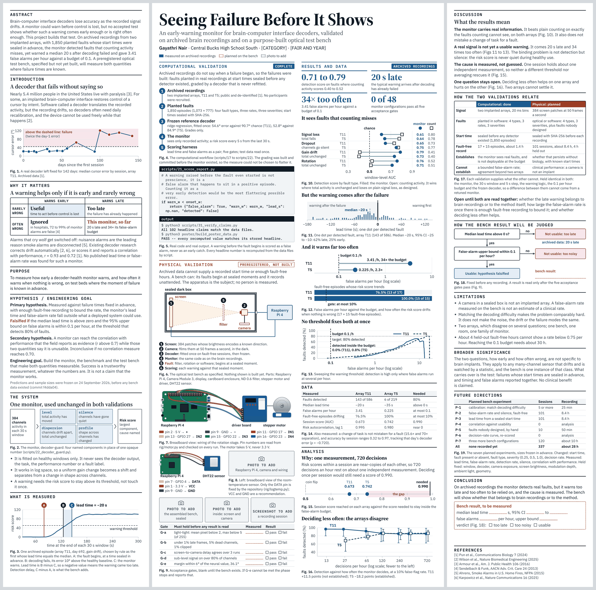

# The trifold poster

A science-fair trifold: left 12 in, centre 24 in, right 12 in. Drafts 1 to 3
are 36 inches tall. **Draft 4, the current one, is 48 inches wide by 48 inches
tall.** The canvas holds **four drafts on four pages**, so the designs can be
compared side by side:
<https://claude.ai/artifact/FRdqcb8LDn5hR2nhjJTEy3> (private until shared from
its Share menu).

| Page | What it is | Status |
|---|---|---|
| **Draft 1** | the first design: thirteen figures, a measured chart beside an empty template for each quantity | kept as a record; type too small to read |
| **Draft 2** | "the project in one minute": a dark band in the centre, the method prominent, data at the side | superseded |
| **Draft 3** | the data and its analysis in the centre, the discussion on the right | superseded |
| **Draft 4** | 48 × 48 in. First half: the system and its two validations, each beside its own diagrams, code and photo spaces. Second half: data and analysis, then the discussion | **current** |



Earlier drafts: [Draft 1](preview/draft1.png), [Draft 2](preview/draft2.png),
[Draft 3](preview/draft3.png).

---

## How Draft 4 is organised

The centre panel is laid out as two 12 inch columns, so the board reads as
four columns from left to right. Columns 1 and 2 are the first half (what the
system is and how it was tested). Columns 3 and 4 are the second half (what
was found and what it means).

| Column | Where | Sections | Figures |
|---|---|---|---|
| **1** | left panel | Abstract (top-left), Introduction, Why it matters, Purpose, Hypothesis / Engineering goal, The system, What is measured | 1 to 3 |
| **2** | centre, left half | **Computational validation** (workflow, real code, real output), then **Physical validation** (bench drawing, two wiring diagrams, photo spaces, acceptance gates) | 4 to 9 |
| **3** | centre, right half | **Results and data** (four numbers, four charts, the data table), **Analysis** (two charts) | 10 to 16 |
| **4** | right panel | **Discussion**, How the two validations relate, How the bench result will be judged, Limitations, Broader significance, Future directions, Conclusion, References | 17 to 19 |

Computational material is marked in blue with a "complete" tag. Physical
material is marked in orange with a "preregistered, not built" tag. The two
never share a figure.

What the taller board brought back from earlier drafts: the monitor's four
components, the definition of lead time on a real episode, the real code and
verifier output, the five acceptance gates, the list of seven experiments with
their variables, the secondary hypothesis, and a side-by-side account of what
each validation can and cannot establish.

## How Draft 3 was organised

| Panel | Sections |
|---|---|
| **Left** | Abstract (top-left), Introduction, Why it matters, Purpose, Hypothesis / Engineering goal, Materials and methods |
| **Centre** | Title, The project in one minute, **Results and data**, **Analysis** |
| **Right** | **Discussion**, What is shown and what is not, Conclusion, Next steps, Pictures and hardware, References |

The centre carries six real charts and the four numbers they support. The
method is one compact block on the left. Colour is the first draft's: white,
ink, blue for what was measured, orange for what is still to be measured.
There is no dark band and no yellow.

### Why each draft was replaced

- **Draft 1 to Draft 2.** The type was too small and the board was crowded.
  The size check below counts 625 pieces of text under 24 pt in Draft 1.
- **Draft 2 to Draft 3.** The researcher's review: the method took the centre
  and the data and analysis were pushed to one side, and the navy band and
  yellow highlighter did not fit the rest of the board.
- **Draft 3 to Draft 4.** The researcher's brief: a larger board whose first
  half introduces the system and explains both validations with real project
  material placed beside the explanation it supports, whose second half holds
  the data, results and analysis, and whose right-hand panel is for discussion
  and interpretation. Nothing was to be shortened only to make it fit.

## The size rule

**Drafts 2 and 3: nothing is smaller than 24 pt** (32 px at 96 px per inch),
including axis numbers, captions and labels inside diagrams.

**Draft 4 has two sizes, both set by the researcher.** Paragraphs and headings
are 24 pt or larger. Small text may go down to **20 pt** (27 px) and no
further. On Draft 4 the 20 pt size is used for: figure captions, axis numbers
and labels inside charts and diagrams, table cells, the code and output
blocks, the one-line descriptions under the workflow steps and under the four
large numbers, the pin lists, the reference list, and the one-line note on
when the predictions were frozen. The researcher's answer named "captions and
axis labels"; the rest of that list is an extension of it and is hers to
accept or push back up.

It is checked by program, not by eye:

```
python3 poster/render_check/preview.py
node poster/render_check/measure.js poster/render_check/out draft4
```

The second command renders each panel, measures every piece of text (including
text inside charts, after scaling), and fails if any is under the floor, if a
panel overflows its height, or if anything runs past a panel's right edge. For
Draft 4 it also prints how many pieces of text sit between 20 and 24 pt (410
across the three panels). It cannot tell a paragraph from a caption, so the
24 pt rule for paragraphs rests on the builder, which has only two sizes. It
needs Node with Playwright.

The program does not catch labels that collide. Those were found by looking at
the rendered panels at full size, and are listed in the research log.

## What is real and what is not (Draft 4)

| On the board | Status |
|---|---|
| Charts (Figs 1, 3, 10 to 13, 15, 16) | **real**, drawn from `data/processed/` by script |
| The four large numbers and the data table (Fig. 14) | **real**, same source |
| Code (Fig. 5) | **real**: six lines quoted from `scripts/21_score_report.py`. The build stops if those lines are no longer in that file |
| Output (Fig. 5) | **real**: the last line each of the two named commands prints, re-run and compared on 12 November 2026 |
| Wiring diagrams (Figs 7, 8) | **real**: the repository's own `physical/figures/wiring-stepper.svg` and `wiring-dht22.svg`, with their small labels removed and large ones added. Pin numbers are the ones `rig/motor.py` and `rig/logtemp.py` use |
| Monitor and workflow diagrams (Figs 2, 4) | drawings of what the code does |
| Bench drawing (Fig. 6) | a drawing of a **specification**; nothing is built |
| Three photographs and one screenshot | **grey placeholders**, labelled "to add" |
| Acceptance gates (Fig. 9), the verdict (Fig. 18), the conclusion box | **blanks**; there is no physical measurement |
| Experiment list (Fig. 19) | **planned** sizes from the preregistration; "none recorded yet" |

## Where every number comes from

```
python3 poster/build_poster_data.py
```

recomputes what each chart plots and **refuses to write** if a value disagrees
with the headline the repository already publishes for it (45 checks).

```
python3 poster/build_draft4.py
```

assembles Draft 4 (`build_draft3.py` and `build_draft2.py` do the same for
theirs). Sentences that need a measured number take it from
`poster_data.json`.

| File | What it is |
|---|---|
| `build_poster_data.py` | recomputes and checks every plotted value |
| `poster_data.json` | the checked values, each with the file it came from |
| `charts.py` | the charts |
| `build_draft4.py` | Draft 4: words, diagrams and layout |
| `build_draft3.py` | Draft 3 |
| `build_draft2.py` | Draft 2, and the components Drafts 2 and 3 share |
| `assets/`, `assets.json` | the two relabel-ready wiring drawings, and where they live on the canvas |
| `canvas/project/` | every artboard exactly as published, and the canvas index |
| `render_check/` | the fit-and-size check |
| `preview/` | one picture per draft |

Draft 1 has no builder here. Its three files in `canvas/project/` (`D1-*`) are
the first design exactly as published, restored from the commit that recorded
it (`68f2f30`), where its builder can also be found.

## What other people's work is cited, and what was checked

Each statement about outside work was looked up on 12 November 2026.

| Ref | Used for | Checked |
|---|---|---|
| [1] Pun et al., *Communications Biology* 7 (2024) | the dataset; a decoder left fixed for 142 days; the correlations r = 0.93 and 0.72 | found; abstract confirms both correlations |
| [2] Wilson et al., *Nature Biomedical Engineering* (2025) | decoders often need daily recalibration; the device cannot be used freely during it; automatic correction | found; wording taken from the paper |
| [3] Armour et al., *Am. J. Public Health* 106 (2016) | nearly 5.4 million people in the United States live with paralysis | found |
| [4] Sendelbach & Funk, *AACN Adv. Crit. Care* 24 (2013) | 72 to 99% of hospital monitor alarms are false | found **as reported** in a federal patient-safety report; the paper itself was not opened |
| [5] Ahrens, *Smoke Alarms in U.S. Home Fires*, NFPA (2015) | nuisance alarms are the leading reason smoke alarms are disconnected | found in the NFPA fact sheet |
| [6] Karpowicz et al., *Nature Communications* 16 (2025) | automatic correction of drift | found |

**Two things that could not be confirmed, and so are not on the board:**

- *Swanson et al. (2026)*, the recalibration review in the September
  bibliography. A web search did not find it. Its DOI does resolve to the
  publisher's site, but the page could not be opened from here, so its title
  and authors are unconfirmed. **Check it before the December plan.**
- The claim that many potential users would not accept daily retraining. It is
  repeated in the literature, but the survey it is attributed to could not be
  confirmed to contain it.

**"No published lead time or false-alarm rate was found."** That sentence is a
statement about a search, not a proof of absence. A targeted search for a
decoder-health monitor reporting either number returned none; the closest
work, [1], says such a monitor would be useful and reports a correlation.

## Why "early warning" is argued the way it is

The intuitive argument is that preventing a failure beats repairing one. The
evidence supports something narrower. In fields that rely on alarms, a warning
that is late or often wrong is not merely less useful, it gets ignored or
switched off [4, 5]. So the case for a decoder-health monitor cannot rest on
"prevention is better". It has to rest on two measured numbers: how early, and
how often wrong. That is the gap the project addresses, and its own result so
far is that the monitor does not pass.

## Things on the poster that are the researcher's to confirm

- **The title**, from the September research plan, and the subtitle.
- **The category and fair name**, shown as `[CATEGORY]` and `[FAIR AND YEAR]`.
- **The board size**, 48 × 48 inches. Check the fair's display rules for the
  largest board it allows before buying one; that was not looked up here.
- **Which charts** sit in the results column, their order, and the sentence
  over each one. Those sentences are claims about the data and should be
  checked against it.
- **What is set at 20 pt**, listed under "The size rule".
- **The abstract.** A draft of about 110 words, not a fair's official form.
- **The wording of the discussion, the limitations, the broader significance
  and the conclusion.** These are interpretation, and interpretation is the
  researcher's.
- **Which code excerpt is shown.** The one on the board is the rule that a
  warning raised before the fault began counts as a false alarm.
- **Type.** Source Serif 4 headings, IBM Plex Sans text.

## What is not on Draft 4

Still in the repository, and on the earlier drafts: the empty "awaiting
measurement" chart templates and the chart of accuracy against decoder error
by session (Draft 1); the thin "project in one minute" row (Draft 3).

Shortened while fitting Draft 4, with where the information still is:

- The decoder's error and chance level left the data table. Both are in step 3
  of the workflow (Fig. 4).
- "0.5 is a coin flip" left the first large number. Chance is marked on the
  chart directly under it (Fig. 10).
- "About 1.4 h" of fault-free recording left the caption of Fig. 12. It is in
  Fig. 17 and in the limitations.
- The fifth workflow step no longer says the silence gate is applied first.
  The discussion says silence is the binding problem.
- The acceptance-gate rows are worded more briefly than in the
  preregistration (G-d, for example, leaves out its "median agreement above
  0.02" condition). The preregistration remains the authority:
  `physical/docs/09_PREREGISTRATION.md`.

## Known limits

- Checked by rendering locally, not on paper. Print one panel at full size
  before printing the board.
- The code excerpt wraps: at 20 pt a 12 inch column holds about 63 characters
  and the source lines are longer.
- The bench drawing shows the computer outside the enclosure. The repository
  does not fix where it sits.
- The two wiring diagrams are not on the same scale as each other.
- References are abbreviated to the first author.
