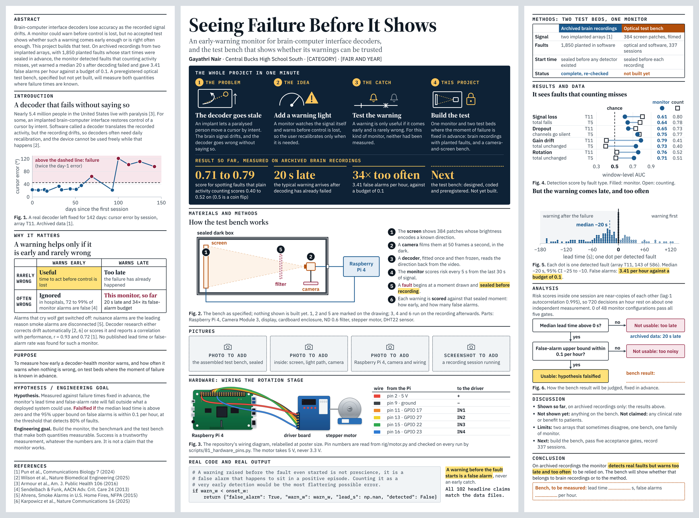

# The trifold poster

**Second design, 12 November 2026.** A 48 × 36 inch science-fair trifold in
three panels: left 12 in, centre 24 in, right 12 in.



The editable poster lives on a design canvas:
<https://claude.ai/artifact/FRdqcb8LDn5hR2nhjJTEy3> (private until shared from
its Share menu). Everything needed to rebuild it is in this folder.

---

## How it is organised

The board follows one line of argument: the problem, why it matters, what the
project proposes, how the system works, how it was tested, what the data show,
what that means, and what is still unknown. The standard section names a judge
looks for are all present.

| Panel | Sections |
|---|---|
| **Left** | Abstract (top-left), Introduction, Why it matters, Purpose, Hypothesis / Engineering goal, References |
| **Centre** | Title, *The whole project in one minute*, Materials and methods, Pictures, Hardware, Real code and real output |
| **Right** | Methods (the two test beds compared), Results and data, Analysis, Discussion, Conclusion |

The centre panel is the way in. Its dark band explains the project in four
steps with no background assumed, then states the result so far in three large
numbers. Everything technical sits around it.

## The size rule

**Nothing on the board is smaller than 24 pt (32 px at 96 px per inch).** That
includes axis numbers, captions and labels inside diagrams. It is checked by
program, not by eye:

```
python3 poster/render_check/preview.py
node poster/render_check/measure.js poster/render_check/out
```

The second command renders each panel, measures every piece of text (including
text inside charts, after scaling), and fails if any is under 32 px, if a panel
overflows its 36 inches, or if anything runs past a panel's right edge. It
needs Node with Playwright.

## What is real and what is not

| On the board | Status |
|---|---|
| Charts (Figs 1, 4, 5) | **real**, drawn from `data/processed/` by script |
| The three large numbers in the dark band | **real**, same source |
| Wiring diagram (Fig. 3) | **real**: the repository's own `physical/figures/wiring-stepper.svg`, with its small labels removed and large ones added |
| The five lines of code | **real**: copied from `scripts/21_score_report.py`; the build stops if those lines are no longer in that file |
| "All 102 headline claims match the data files." | **real** output of `scripts/31_verify_claims.py` |
| Bench drawing (Fig. 2) | a drawing of a **specification**; nothing is built |
| Photographs and the screenshot | **grey placeholders**, labelled "to add" |
| Bench results | **blanks**; there is no physical measurement |

## Where every number comes from

```
python3 poster/build_poster_data.py
```

recomputes what each chart plots and **refuses to write** if a value disagrees
with the headline the repository already publishes for it (45 checks).

```
python3 poster/build_poster.py
```

assembles the three panels. Sentences that need a measured number take it from
`poster_data.json`.

| File | What it is |
|---|---|
| `build_poster_data.py` | recomputes and checks every plotted value |
| `poster_data.json` | the checked values, each with the file it came from |
| `charts.py` | the charts |
| `build_poster.py` | the words, diagrams and layout |
| `assets/` | the relabel-ready wiring drawing, derived from `physical/figures/` |
| `assets.json` | where each uploaded asset lives on the canvas |
| `canvas/project/` | the built panels, exactly as published |
| `render_check/` | the fit-and-size check |
| `preview/` | pictures of the panels |

## What other people's work is cited, and what was checked

Each statement about outside work was looked up on 12 November 2026.

| Ref | Used for | Checked |
|---|---|---|
| [1] Pun et al., *Communications Biology* 7 (2024) | the dataset; a decoder left fixed for 142 days; the correlations r = 0.93 and 0.72 | found; abstract confirms both correlations |
| [2] Wilson et al., *Nature Biomedical Engineering* (2025) | decoders often need daily recalibration; the device cannot be used freely during it; automatic correction | found; wording taken from the paper |
| [3] Armour et al., *Am. J. Public Health* 106 (2016) | nearly 5.4 million people in the United States live with paralysis | found |
| [4] Sendelbach & Funk, *AACN Adv. Crit. Care* 24 (2013) | 72 to 99% of hospital monitor alarms are false | found **as reported** in a federal patient-safety report; the paper itself was not opened |
| [5] Ahrens, *Smoke Alarms in U.S. Home Fires*, NFPA (2015) | nuisance alarms are the leading reason smoke alarms are disconnected | found in the NFPA fact sheet |
| [6] Karpowicz et al., *Nature Communications* 16 (2025) | automatic correction of drift | found |

**Two things that could not be confirmed, and so are not on the board:**

- *Swanson et al. (2026)*, the recalibration review in the September
  bibliography. A web search did not find it. Its DOI does resolve to the
  publisher's site, but the page could not be opened from here, so its title
  and authors are unconfirmed. **Check it before the December plan.**
- The claim that many potential users would not accept daily retraining. It is
  repeated in the literature, but the survey it is attributed to could not be
  confirmed to contain it.

**"No published lead time or false-alarm rate was found."** That sentence is a
statement about a search, not a proof of absence. A targeted search for a
decoder-health monitor reporting either number returned none; the closest
work, [1], says such a monitor would be useful and reports a correlation.

## Why "early warning" is argued the way it is

The intuitive argument is that preventing a failure beats repairing one. The
evidence supports something narrower. In fields that rely on alarms, a warning
that is late or often wrong is not merely less useful, it gets ignored or
switched off [4, 5]. So the case for a decoder-health monitor cannot rest on
"prevention is better". It has to rest on two measured numbers: how early, and
how often wrong. That is the gap the project addresses, and its own result so
far is that the monitor does not pass.

## Things on the poster that are the researcher's to confirm

- **The title**, from the September research plan, and the subtitle.
- **The category and fair name**, shown as `[CATEGORY]` and `[FAIR AND YEAR]`.
- **The board size**, 48 × 36 inches.
- **The four-step story** in the dark band, and its everyday comparisons
  (a warning light, alarms that cry wolf).
- **The abstract.** It is a draft of about 110 words. A fair's official
  abstract form has its own rules and word limit.
- **The wording of the conclusion and discussion.**
- **The dark band.** It is the one large area of solid ink on the board.
- **Type.** Source Serif 4 headings, IBM Plex Sans text.

## What was cut to reach 24 pt

The first design held thirteen figures at about half this type size. Raising
the floor to 24 pt and giving room to photographs and the wiring diagram meant
cutting. Gone from the board, and still in the repository: the six empty
"awaiting measurement" chart templates, the five-gate dashboard, the variables
table, the seven-experiment table, the decision-rate chart and the monitor's
four-component diagram. `charts.py` still contains the template functions, for
when there are bench results to draw.

## Known limits

- Checked by rendering locally, not on paper. Print one panel at full size
  before printing the board.
- The bench drawing shows the computer outside the enclosure. The repository
  does not fix where it sits.
- References are abbreviated to the first author.
