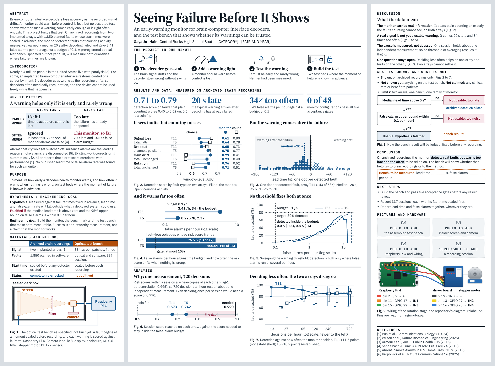

# The trifold poster

A 48 × 36 inch science-fair trifold: left 12 in, centre 24 in, right 12 in.
The canvas holds **three drafts on three pages**, so the designs can be
compared side by side:
<https://claude.ai/artifact/FRdqcb8LDn5hR2nhjJTEy3> (private until shared from
its Share menu).

| Page | What it is | Status |
|---|---|---|
| **Draft 1** | the first design: thirteen figures, a measured chart beside an empty template for each quantity | kept as a record; type too small to read |
| **Draft 2** | "the project in one minute": a dark band in the centre, the method prominent, data at the side | superseded |
| **Draft 3** | the data and its analysis in the centre, the discussion on the right | **current** |



Earlier drafts: [Draft 1](preview/draft1.png), [Draft 2](preview/draft2.png).

---

## How Draft 3 is organised

| Panel | Sections |
|---|---|
| **Left** | Abstract (top-left), Introduction, Why it matters, Purpose, Hypothesis / Engineering goal, Materials and methods |
| **Centre** | Title, The project in one minute, **Results and data**, **Analysis** |
| **Right** | **Discussion**, What is shown and what is not, Conclusion, Next steps, Pictures and hardware, References |

The centre carries six real charts and the four numbers they support. The
method is one compact block on the left. Colour is the first draft's: white,
ink, blue for what was measured, orange for what is still to be measured.
There is no dark band and no yellow.

### Why each draft was replaced

- **Draft 1 to Draft 2.** The type was too small and the board was crowded.
  The size check below counts 625 pieces of text under 24 pt in Draft 1.
- **Draft 2 to Draft 3.** The researcher's review: the method took the centre
  and the data and analysis were pushed to one side, and the navy band and
  yellow highlighter did not fit the rest of the board.

## The size rule

**Nothing on the board is smaller than 24 pt (32 px at 96 px per inch).** That
includes axis numbers, captions and labels inside diagrams. It is checked by
program, not by eye:

```
python3 poster/render_check/preview.py
node poster/render_check/measure.js poster/render_check/out draft3
```

The second command renders each panel, measures every piece of text (including
text inside charts, after scaling), and fails if any is under 32 px, if a panel
overflows its 36 inches, or if anything runs past a panel's right edge. It
needs Node with Playwright.

## What is real and what is not

| On the board | Status |
|---|---|
| Charts (Figs 2 to 7) | **real**, drawn from `data/processed/` by script |
| The four large numbers above the charts | **real**, same source |
| Wiring diagram (Fig. 9) | **real**: the repository's own `physical/figures/wiring-stepper.svg`, with its small labels removed and large ones added |
| Bench drawing (Fig. 1) | a drawing of a **specification**; nothing is built |
| Photographs and the screenshot | **grey placeholders**, labelled "to add" |
| Real code and verifier output | on Draft 2 only; left off Draft 3 to give the data the room |
| Bench results | **blanks**; there is no physical measurement |

## Where every number comes from

```
python3 poster/build_poster_data.py
```

recomputes what each chart plots and **refuses to write** if a value disagrees
with the headline the repository already publishes for it (45 checks).

```
python3 poster/build_draft3.py
```

assembles Draft 3. Sentences that need a measured number take it from
`poster_data.json`.

| File | What it is |
|---|---|
| `build_poster_data.py` | recomputes and checks every plotted value |
| `poster_data.json` | the checked values, each with the file it came from |
| `charts.py` | the charts |
| `build_draft3.py` | Draft 3: words, diagrams and layout |
| `build_draft2.py` | Draft 2, and the components both drafts share |
| `assets/`, `assets.json` | the relabel-ready wiring drawing, and where it lives on the canvas |
| `canvas/project/` | every artboard exactly as published, and the canvas index |
| `render_check/` | the fit-and-size check |
| `preview/` | one picture per draft |

Draft 1 has no builder here. Its three files in `canvas/project/` (`D1-*`) are
the first design exactly as published, restored from the commit that recorded
it (`68f2f30`), where its builder can also be found.

## What other people's work is cited, and what was checked

Each statement about outside work was looked up on 12 November 2026.

| Ref | Used for | Checked |
|---|---|---|
| [1] Pun et al., *Communications Biology* 7 (2024) | the dataset; a decoder left fixed for 142 days; the correlations r = 0.93 and 0.72 | found; abstract confirms both correlations |
| [2] Wilson et al., *Nature Biomedical Engineering* (2025) | decoders often need daily recalibration; the device cannot be used freely during it; automatic correction | found; wording taken from the paper |
| [3] Armour et al., *Am. J. Public Health* 106 (2016) | nearly 5.4 million people in the United States live with paralysis | found |
| [4] Sendelbach & Funk, *AACN Adv. Crit. Care* 24 (2013) | 72 to 99% of hospital monitor alarms are false | found **as reported** in a federal patient-safety report; the paper itself was not opened |
| [5] Ahrens, *Smoke Alarms in U.S. Home Fires*, NFPA (2015) | nuisance alarms are the leading reason smoke alarms are disconnected | found in the NFPA fact sheet |
| [6] Karpowicz et al., *Nature Communications* 16 (2025) | automatic correction of drift | found |

**Two things that could not be confirmed, and so are not on the board:**

- *Swanson et al. (2026)*, the recalibration review in the September
  bibliography. A web search did not find it. Its DOI does resolve to the
  publisher's site, but the page could not be opened from here, so its title
  and authors are unconfirmed. **Check it before the December plan.**
- The claim that many potential users would not accept daily retraining. It is
  repeated in the literature, but the survey it is attributed to could not be
  confirmed to contain it.

**"No published lead time or false-alarm rate was found."** That sentence is a
statement about a search, not a proof of absence. A targeted search for a
decoder-health monitor reporting either number returned none; the closest
work, [1], says such a monitor would be useful and reports a correlation.

## Why "early warning" is argued the way it is

The intuitive argument is that preventing a failure beats repairing one. The
evidence supports something narrower. In fields that rely on alarms, a warning
that is late or often wrong is not merely less useful, it gets ignored or
switched off [4, 5]. So the case for a decoder-health monitor cannot rest on
"prevention is better". It has to rest on two measured numbers: how early, and
how often wrong. That is the gap the project addresses, and its own result so
far is that the monitor does not pass.

## Things on the poster that are the researcher's to confirm

- **The title**, from the September research plan, and the subtitle.
- **The category and fair name**, shown as `[CATEGORY]` and `[FAIR AND YEAR]`.
- **The board size**, 48 × 36 inches.
- **Which six charts** sit in the centre, their order, and the sentence over
  each one. Those sentences are claims about the data and should be checked
  against it.
- **The thin "project in one minute" row** above the results. It is the only
  part of the centre that is not data or analysis, and it can go.
- **The abstract.** A draft of about 110 words, not a fair's official form.
- **The wording of the discussion and conclusion.**
- **Type.** Source Serif 4 headings, IBM Plex Sans text.

## What is not on Draft 3

Still in the repository, and on the earlier drafts: the empty "awaiting
measurement" chart templates, the five-gate dashboard, the variables and
experiment tables (Draft 1); the numbered account of how the bench works, the
real code and verifier output (Draft 2).

## Known limits

- Checked by rendering locally, not on paper. Print one panel at full size
  before printing the board.
- The bench drawing shows the computer outside the enclosure. The repository
  does not fix where it sits.
- References are abbreviated to the first author.
